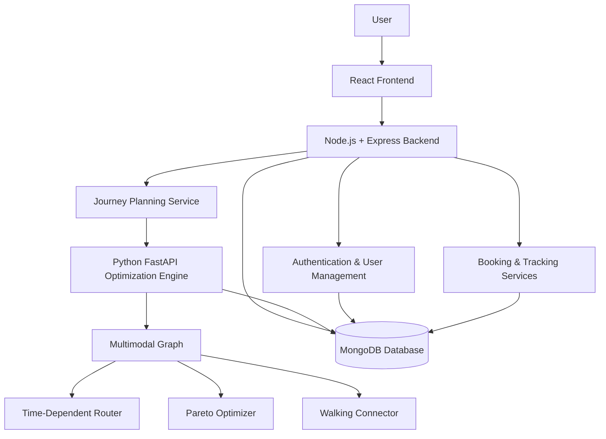

# 🚍 TransitChain – Smart Multimodal Journey Planner

<p align="center">
  
  
  
  
  
</p>

<p align="center">
  <b>One Journey. Multiple Transport Modes. Smarter Decisions.</b>
</p>

---

## 🌍 About TransitChain

TransitChain is a smart multimodal transportation and journey-planning platform designed to simplify urban travel.

Traditional journey-planning applications often focus on finding the shortest or fastest route. However, real-world commuters also consider ticket prices, walking distance, waiting time, transfers, and convenience.

TransitChain addresses this challenge by integrating multiple transportation modes, including buses, metro, and walking, into a unified journey-planning experience.

The platform uses graph-based algorithms and multi-objective optimization to generate and compare alternative journeys, helping users choose routes that best match their preferences.

## 🎯 Problem Statement

Urban commuters frequently face difficulties when planning journeys involving multiple transportation modes.

Some common challenges include:

- Lack of unified information across transportation modes.
- Difficulty comparing travel time and journey costs.
- Complicated transfers between different transport services.
- Inefficient route suggestions based only on distance or travel time.
- Difficulty finding convenient walking connections.
- Limited visibility into the complete door-to-door journey.

**TransitChain aims to solve these problems through intelligent multimodal route planning and optimization.**

## ✨ Key Features

### 🗺️ 1. Multimodal Journey Planning
- Plan journeys using buses, metro, and walking.
- Combine multiple transportation modes into one journey.
- Generate complete door-to-door travel alternatives.
- Display intermediate stops and transfers.

### ⚡ 2. Intelligent Route Optimization
- Time-dependent shortest-path routing.
- Multi-objective route optimization.
- Fare and travel-time comparison.
- Transfer penalties and walking-distance considerations.
- Personalized route selection based on user preferences.

### 📍 3. Location-Based Journey Search
- Search using source and destination locations.
- Support location-based origin selection.
- Help users identify nearby transport stops.
- Provide walking connections between transport points.

### 🎫 4. Booking Management
- View and manage journey bookings.
- Access booking information.
- Track journeys through the booking interface.
- Support booking integrations where partner access is available.

### 📡 5. Journey Tracking
- View journey progress.
- Follow transport connections.
- Access relevant journey information.

### 🤖 6. Travel Assistance Chatbot
- Assist users with journey-related questions.
- Provide travel information.
- Suggest relevant places and food options around destinations.

### 👤 7. Authentication and User Management
- Email OTP-based registration and verification.
- Secure login and authentication.
- JWT-based session management.
- User profile management.

### 🛡️ 8. Admin Dashboard
- Manage transportation providers.
- Manage locations, stops, routes, and trips.
- Monitor platform data.
- Manage administrative operations.

## 🧠 Core Algorithms and Research Innovation

One of the major aspects of TransitChain is its focus on multi-objective journey optimization.

Instead of selecting a route based only on minimum travel time, the system considers several factors.

### 1. Multimodal Graph Representation

The transportation network is represented as a directed graph.

- Nodes represent stops, stations, and connected locations.
- Edges represent transportation connections.
- Edge attributes contain relevant travel information.
- Different transportation modes are represented within the same network.

### 2. Time-Dependent Shortest Path

Travel times can change depending on departure time and transport schedules.

The time-dependent routing algorithm evaluates journey connections according to departure time and available transportation information.

### 3. Pareto-Based Multi-Objective Optimization

TransitChain explores alternative journeys using Pareto-based optimization.

The optimization considers:

- Total travel time.
- Total fare.
- Walking distance.
- Number of transfers.
- User preferences.

Rather than always selecting one shortest route, the system can identify multiple non-dominated alternatives.

### 4. Weighted Route Scoring

A weighted scoring mechanism can rank available alternatives according to user preferences.

For example:

- A user prioritizing speed can prefer shorter journeys.
- A budget-conscious user can prioritize lower fares.
- A user prioritizing convenience can minimize transfers and walking distance.

### 5. Walking Connection Calculation

Walking connections can be calculated using geographical coordinates and the Haversine distance formula.

This helps connect nearby transportation stops and improve door-to-door journey planning.

## 🏗️ Technology Stack

| Category | Technologies |
|---|---|
| Frontend | React.js, JavaScript, CSS |
| Backend | Node.js, Express.js |
| Database | MongoDB, Mongoose |
| Optimization Services | Python, FastAPI |
| Routing Algorithms | NetworkX, Graph Algorithms |
| Authentication | JWT, Email OTP |
| Location Processing | Haversine Distance |
| Development Tools | Git, GitHub, Postman, VS Code |

## 🔄 System Architecture



## 📂 Project Structure

```text
TransitChain/
│
├── frontend/
│   ├── public/
│   └── src/
│       ├── assets/
│       ├── components/
│       ├── pages/
│       ├── services/
│       ├── context/
│       └── App.jsx
│
├── backend/
│   ├── config/
│   ├── controllers/
│   ├── middleware/
│   ├── models/
│   ├── routes/
│   ├── services/
│   ├── scripts/
│   ├── utils/
│   └── server.js
│
├── optimization/
│   ├── main.py
│   ├── multimodal_graph.py
│   ├── time_dependent_search.py
│   ├── pareto_optimizer.py
│   └── walking_connector.py
│
└── README.md
```

*Note: This is a conceptual structure. Adjust folder names to match the actual repository.*

## ⚙️ Installation and Setup

### Prerequisites

- Node.js and npm
- Python 3.10+
- MongoDB
- Git

### 1. Clone the Repository

```bash
git clone https://github.com/DaggupatiLeelaNaren/transitchain.git

cd transitchain
```

### 2. Setup Backend

```bash
cd backend

npm install
```

Create a `.env` file in the backend directory and configure your environment variables.

```env
PORT=5000
MONGO_URI=your_mongodb_connection_string

JWT_SECRET=your_jwt_secret
JWT_EXPIRES_IN=1d

OTP_SECRET=your_otp_secret

EMAIL_USER=your_email
EMAIL_APP_PASSWORD=your_email_app_password
SMTP_HOST=smtp.gmail.com
SMTP_PORT=587
SMTP_SECURE=false
```

Start the backend:

```bash
npm run dev
```

### 3. Setup Frontend

Open another terminal:

```bash
cd frontend

npm install

npm run dev
```

### 4. Setup Python Optimization Service

Open another terminal:

```bash
cd optimization

python -m venv venv
```

Activate the virtual environment.

**Windows:**

```bash
venv\Scripts\activate
```

Install dependencies:

```bash
pip install fastapi uvicorn networkx
```

Start the FastAPI server:

```bash
uvicorn main:app --reload --port 8000
```

*Note: Install any additional dependencies specified in your project's requirements.txt file. The commands above assume the corresponding entry points and scripts are present.*

## 🔬 Research Objectives

TransitChain explores the following research question:

**Can multi-objective route optimization generate more practical and user-friendly journeys than traditional shortest-path algorithms that prioritize travel time alone?**

The project investigates:

1. Multimodal graph-based transportation modeling.
2. Time-dependent shortest-path algorithms.
3. Pareto-frontier-based route optimization.
4. Transfer and walking penalties.
5. User-preference-based route ranking.
6. Comparison of travel-time-only and multi-objective routing approaches.

## 🚀 Future Enhancements

- Real-time public transportation data integration.
- Live vehicle tracking and estimated arrival times.
- Additional transportation provider integrations.
- More advanced route optimization techniques.
- Improved personalized travel recommendations.
- Expanded booking integrations.
- Mobile application support.
- Journey analytics and travel insights.

## 🎓 Project Highlights

- Full-stack application development.
- Research-oriented algorithm implementation.
- Graph-based multimodal transportation modeling.
- Multi-objective optimization.
- REST API development and integration.
- Database design and management.
- Authentication and role-based access control.
- Responsive user interface development.

## 👨‍💻 Developer

**Leela Naren Daggupati**

Full Stack Developer | Software Engineer | Problem Solver

- GitHub: [@DaggupatiLeelaNaren](https://github.com/DaggupatiLeelaNaren)
- Portfolio: [My Portfolio](https://github.com/DaggupatiLeelaNaren/Portfolio)

---

<p align="center">
  ⭐ If you find TransitChain interesting, consider giving this repository a star!
  <br/><br/>
  <b>Making Urban Mobility Smarter, Simpler, and More Connected. 🚍</b>
</p>
